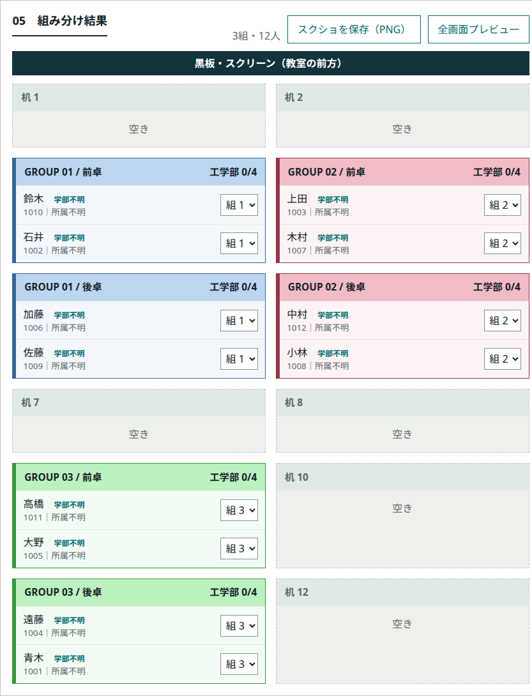

# 授業内グループ分け

UNIPA（Universal Passport）の標準出席CSVに対応した、授業のグループと座席を決めるツールです。単一のHTMLで動作し、読み込んだCSVはブラウザ内で処理します。初期状態の学生マスターは空です。



*画面例は架空の学生7人を3組に分けたものです。黒板の帯が教室の前方を示し、色付きのカードが各組の座席、灰色のカードが空き卓です。*

## 使い方

1. [GitHub Pagesでツールを開きます](https://novelsavage.github.io/classroom-grouping-tool/)。オフラインで使う場合は [index.html](https://raw.githubusercontent.com/novelsavage/classroom-grouping-tool/main/index.html) を保存してブラウザで開きます。
2. UNIPAから出力した出席CSVを読み込み、対象日を選びます。既定では出席・遅刻・早退の学生が対象です。公欠を含めたり、一覧のチェックで個別に調整したりできます。
3. 授業の設定を選び、実際の教室に合わせて机の列数と行数を指定します。「優先する組の人数」と「所属による分散」は個別に変更できます。
4. 「グループを生成」を押します。結果は全画面で投影でき、組番号と机の行・列・席番号をCSVに保存できます。

| 授業の設定 | 組の人数 | 所属 | 配置 |
| --- | --- | --- | --- |
| プログラミング基礎（既定） | 3人優先。余りは2人組で調整（7人なら3・2・2） | 所属による分散なし | 1組につき1卓 |
| Data Visualization | 机の配置に合わせて4人組を優先し、残りを調整 | 工学部を各組に分散 | 4人組は前後2卓に2人ずつ。3人以下は1卓 |
| カスタム | 2・3・4人から選択。2人優先で対象者が奇数なら1人組が1つできる | なし／工学部を分散 | 4人組は前後2卓。3人以下は1卓 |

## CSVの形式

出席CSVはUTF-8で保存します。複数の授業日を日付列として追加できます。

```csv
学籍番号,氏名,2026/11/12
1001,サンプル01,出
1002,サンプル02,遅
1003,サンプル03,欠
```

工学部を分散したい場合や、出席CSVを使わず名簿全員を対象にしたい場合は、学生マスターを読み込みます。出席CSVとは氏名列の見出しが異なります。

```csv
学籍番号,名前,所属
1001,サンプル01,工学部
1002,サンプル02,その他
```

GitHub Pages版の名簿はページ内だけで保持し、再読み込みすると消えます。次回も使う場合は「マスターCSVを保存」から書き出し、使うときに読み込んでください。ダウンロードしたHTMLを直接開いた場合は、名簿の追加・更新をブラウザに保存します。
